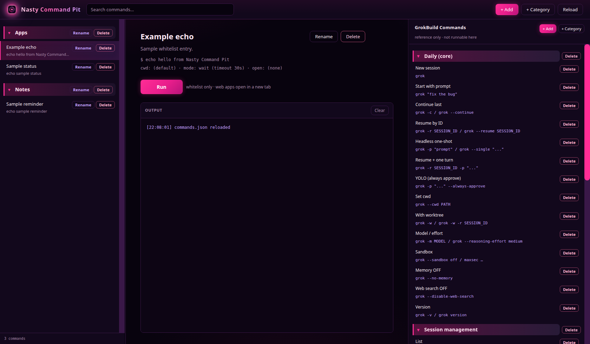

# Nasty Command Pit

Local one-click launcher for a whitelist of commands. Cosmic purple / hot magenta night-ops skin.

Register and rename apps in the UI. The list is saved on disk and still launches with one click.

**Currently private.**

## Screenshots



## Features

- One-click **Run** for whitelisted commands (`subprocess`, never a shell)
- **+ Add** — register a display name, command, category, optional working directory, description, open URL, and background mode
- **+ Category** — add a folder in the list. Rename or delete it from the folder header
- **Rename** on each entry — display name changes immediately; the command stays as shown unless you edit that field
- **Delete** on each entry, and on a category (a category delete also removes the apps inside it, after a confirm)
- **GrokBuild Commands** — add a reference row, add a category, or delete either one. Every delete asks first. Edits stay in the browser and are not launched
- Folders and the Grok Build reference headings collapse. The choice stays in the browser
- Search across the command list and the reference pane
- Resizable panes
- Always-visible vertical scrollbar on the command list
- Binds to `127.0.0.1` only

## Requirements

| Item | Notes |
|------|--------|
| OS | Linux |
| Python | 3.10+ |
| Browser | Any modern browser on this machine |

## Quick start

```bash
git clone git@github.com:TX-220/nasty-command-pit.git
cd nasty-command-pit

python3 -m venv .venv
source .venv/bin/activate
python -m pip install -r requirements.txt

cp commands.example.json commands.json
python server.py
```

Open `http://127.0.0.1:7421/`.

Restart the process after pulling this repo. A server that is already running keeps the old Python routes until it starts again. Then refresh the browser.

`commands.json` is your local whitelist. It is not part of the git tree. Edits from **+ Add** and **Rename** are written there (the previous file is kept as `commands.json.bak`).

To change the port:

```bash
VESPER_LAUNCHER_PORT=7421 python server.py
```

## License

MIT — see [LICENSE](./LICENSE).

Copyright (c) 2026 TX-220 with assistance from [Grok (xAI)](https://x.ai).
